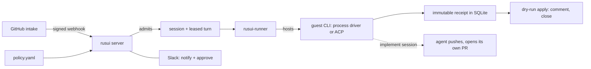

# Rusui (留守居)

**A self-hosted environment plane for coding agents: you write the policy,
it keeps the receipts.**

[](https://github.com/Sannrox/rusui/actions/workflows/build.yml)
[](https://github.com/Sannrox/rusui/releases)
[](LICENSE)

[Try it](#try-it) · [Docs](docs/README.md) · [Architecture](ARCHITECTURE.md) ·
[Security](SECURITY.md) · [Decisions](docs/decisions/README.md)

> **Status:** self-hosted source, loopback by default, dry-run apply for
> comment and close. Not a hosted product.

留守居 is the steward who keeps house while you are away. Rusui gives coding
agents a place to work that you operate: you write `policy.yaml`, the server
admits work onto sessions and turns, records immutable reviews, and
**dry-runs** apply for comment and close. It does not comment, close, or
merge on GitHub. In `implement` sessions the agent pushes and opens its own
pull requests with the operator's credential
([ADR 0015](docs/decisions/0015-agent-publication.md)).

- **Policy is the input.** One `policy.yaml` binds repositories to projects
  and sets the daily review budget and per-project concurrent-lease meter;
  the server admits every session and turn from it
  ([configuration reference](docs/configuration.md)).
- **Dry-run by contract.** Comment and close are deterministic dry runs;
  merge, comment, close, and land stay unauthorized by contract, and human
  merge is required ([ARCHITECTURE.md](ARCHITECTURE.md)).
- **Immutable receipts.** Every turn ends in an immutable review revision
  stored in SQLite, so what ran and what it concluded is on record.
- **Credential discipline.** The intake GitHub client is read-only; a model
  process receives a GitHub write credential only in an `implement` session
  ([ADR 0015](docs/decisions/0015-agent-publication.md)).
- **Loopback and fail-closed.** Examples bind to 127.0.0.1, and the server
  refuses to start without its secrets and a GitHub token
  ([SECURITY.md](SECURITY.md)).
- **Slack as the optional human socket.** Allowlisted users may notify and
  approve; they are not plane operators ([CONTEXT.md](CONTEXT.md)).

## Try it

The first run needs no GitHub, Slack, or model credentials. From a fresh
clone, with Go 1.26 and `make` (`make` pins [`.go-version`](.go-version)):

```bash
git clone https://github.com/Sannrox/rusui.git && cd rusui
make all
BIN="_output/local/bin/$(go env GOOS)/$(go env GOARCH)"
"$BIN/rusui" demo
```

```text
SAMPLE rusui demo — this is not a real review
Project: sample | Session: 1 | Turn: 1 | Item: sample/demo#1
Receipt: complete | Review payload:
{"schema_version":1,"repo":"sample/demo","item":1,"item_kind":"issue","claimed_revision":1,"snapshot_hash":"eef850a8aa770001bb451b4ae3ef1ee759caca8c1e6bca5127c0341e3568978d","main_sha":"sample","head_sha":"","verdict":"keep","confidence":"high","proposed_actions":null,"publishable":{"label":"SAMPLE","sample":true}}
```

The demo admits a fixture issue, runs a deterministic driver, prints its
stored receipt, and removes its temporary state directory before exit. These
are `SAMPLE`-labeled fixture records, not a review of your repository.

From here, the [first-session tutorial](docs/tutorial.md) continues to a
loopback server with a `/healthz` check. To connect a real repository, use
the [operator guide](docs/operator.md); look up flags and policy fields in
the [configuration reference](docs/configuration.md).

## How it works



GitHub is intake. The rusui server is the source of truth. Slack is the
optional human socket. A **project** is the policy and budget domain; a
**session** is one unit of work on one project and one **environment**; a
**turn** is one leased attempt on an unattended session. A runner claims
turns and hosts a guest CLI (process driver or ACP). All the nouns:
[CONTEXT.md](CONTEXT.md). The v1 contract: [ARCHITECTURE.md](ARCHITECTURE.md).

The experimental local-interactive profile is default-off and runs a
policy-configured process through Sumika on the operator's host
([ADR 0016](docs/decisions/0016-local-interactive-runtime.md),
[operator profile](docs/local-interactive.md)).

**Why not let it comment on GitHub?** Live apply is a later milestone,
enabled one action at a time only after recovery tests and a recorded
review-quality evaluation against operator judgments. Model
`confidence = high` is not the promotion criterion, and land is never CI
green alone. Until then, apply is a deterministic dry run and human merge is
required ([ARCHITECTURE.md](ARCHITECTURE.md)).

## What it is not

Live comment, close, merge, or land; unnamed GitHub writes; a dashboard;
or a multi-tenant SaaS. Later milestones and competitive sequencing live
in [VISION.md](VISION.md) and [ROADMAP.md](ROADMAP.md); they are not the
runbook.

## Next

| I want to… | Read |
| --- | --- |
| Walk through a first loopback session | [docs/tutorial.md](docs/tutorial.md) |
| See a sample session and receipt without GitHub | [docs/tutorial.md](docs/tutorial.md#sample-demo-no-github-no-model) |
| Run it against a real repository | [docs/operator.md](docs/operator.md) |
| Review-only GitHub App behind a tunnel | [docs/github-app-pilot.md](docs/github-app-pilot.md) |
| Drain, upgrade, diagnostics | [docs/upgrade.md](docs/upgrade.md) |
| Look up flags, env, HTTP, policy | [docs/configuration.md](docs/configuration.md) |
| Learn the nouns | [CONTEXT.md](CONTEXT.md) |
| Build, test, images | [docs/development.md](docs/development.md) |
| Read the contract | [ARCHITECTURE.md](ARCHITECTURE.md) |
| See accepted direction | [VISION.md](VISION.md), [ROADMAP.md](ROADMAP.md), [docs/decisions/](docs/decisions/) |
| Contribute | [CONTRIBUTING.md](CONTRIBUTING.md), [AGENTS.md](AGENTS.md) |

## Contributing

`make all && make test && make validate` is the contributor gate before a
pull request. Setup and pull-request flow are in
[CONTRIBUTING.md](CONTRIBUTING.md), agent workflow in [AGENTS.md](AGENTS.md).

MIT licensed.
